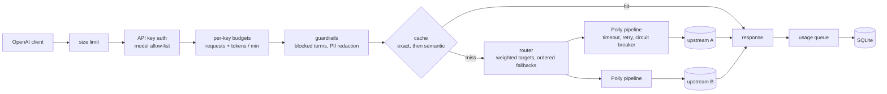

# llm-gateway-dotnet

An OpenAI-compatible LLM gateway built on ASP.NET Core 8.

Clients talk to it exactly as they would talk to the OpenAI API (`/v1/chat/completions`,
`/v1/embeddings`, `/v1/models`, streaming included). Behind it, each model alias is routed to
one or more upstreams: OpenAI, Ollama, vLLM, LM Studio, or anything else that speaks the same
HTTP API. On the way through, the gateway authenticates the caller, applies per-key budgets,
redacts PII, answers repeated prompts from a cache, records token usage, and emits traces and
metrics.

An in-process offline provider is the default upstream, so everything in this repository
runs and is tested without an API key or network access.

## Request path



## Quickstart

Requires the .NET 8 SDK.

```bash
dotnet run --project src/LlmGateway        # http://localhost:5080, Development settings
```

The Development settings define one admin key, `sk-local-dev`:

```bash
curl http://localhost:5080/v1/chat/completions \
  -H "Authorization: Bearer sk-local-dev" \
  -H "Content-Type: application/json" \
  -d '{"model":"chat-default","messages":[{"role":"user","content":"Hello"}]}'
```

Send the same request again and the response carries `X-Gateway-Cache: hit-exact`.

Any OpenAI SDK works by pointing its base URL at the gateway:

```python
from openai import OpenAI
client = OpenAI(base_url="http://localhost:5080/v1", api_key="sk-local-dev")
client.chat.completions.create(model="chat-default", messages=[{"role": "user", "content": "Hi"}])
```

### Docker

```bash
docker compose up
```

starts the gateway on port 8080 with the Redis cache store, plus Redis and Jaeger
(traces at http://localhost:16686). The image is a multi-stage build that runs as a
non-root user; the usage database lives on the `usage-data` volume.

## API

| Method | Path | Notes |
| --- | --- | --- |
| `POST` | `/v1/chat/completions` | Non-streaming and `stream: true` (server-sent events, relayed chunk by chunk). |
| `POST` | `/v1/embeddings` | String or array input. |
| `GET` | `/v1/models`, `/v1/models/{id}` | Only the aliases the calling key may use. |
| `GET` | `/admin/usage?from=&to=&api_key=` | Token and request totals by key and by model. Admin keys only; defaults to the last 24 hours. |
| `GET` | `/health/live` | Process is serving. Checks nothing else. |
| `GET` | `/health/ready` | Usage database and, when used, Redis. |

Errors use the OpenAI error shape (`{"error": {"message", "type", "param", "code"}}`), so
client libraries raise their usual exceptions.

Response headers added by the gateway:

| Header | Meaning |
| --- | --- |
| `X-Gateway-Upstream` | Upstream that produced the response. |
| `X-Gateway-Cache` | `hit-exact`, `hit-semantic`, `miss` or `bypass`. Send `X-Gateway-Cache: bypass` or `Cache-Control: no-cache` to skip the cache. |
| `X-Gateway-Cache-Similarity` | Cosine similarity of the cached prompt behind a semantic hit. |
| `X-Gateway-Pii-Redacted` | Number of values redacted from the prompt. |
| `x-ratelimit-limit-*`, `x-ratelimit-remaining-*` | Request and token budgets of the calling key, as OpenAI sends them. `Retry-After` accompanies a 429. |

## Configuration

Everything lives under the `Gateway` section of `appsettings.json` and can be overridden by
environment variables (`Gateway__Cache__Store=Redis`). The configuration is validated at
startup; an alias pointing at an unknown upstream, for example, stops the process with a
message saying which one.

### Upstreams and routes

```json
"Gateway": {
  "Upstreams": {
    "openai": { "Kind": "OpenAICompatible", "BaseUrl": "https://api.openai.com/v1", "ApiKey": "sk-..." },
    "ollama": { "Kind": "OpenAICompatible", "BaseUrl": "http://localhost:11434/v1", "AttemptTimeout": "00:03:00" }
  },
  "Models": {
    "chat-default": {
      "Kind": "Chat",
      "Targets": [
        { "Upstream": "openai", "Model": "gpt-4o-mini", "Weight": 3 },
        { "Upstream": "openai", "Model": "gpt-4.1-mini", "Weight": 1 }
      ],
      "Fallbacks": [ { "Upstream": "ollama", "Model": "llama3.1:8b" } ]
    }
  }
}
```

- Clients send the alias (`chat-default`); the gateway sends the target's model name upstream.
- Primary targets are tried in a weighted random order, so each is tried first in proportion
  to its weight and the rest still act as fallbacks. `Fallbacks` are tried last, in order.
- Each upstream has its own Polly pipeline: a per-attempt timeout, exponential retry with
  jitter for 5xx, 408, network errors and timeouts, and a circuit breaker (`Gateway:Resilience`).
  A 429 is never retried in place; the router moves to the next target instead. A 400 is
  returned to the caller straight away, since another upstream would reject it too.
- A stream fails over while it is being opened. Once an upstream has accepted it and relaying
  has begun, a broken stream is ended rather than restarted elsewhere.

### API keys

```json
"ApiKeys": {
  "team-search": {
    "KeyHash": "<sha-256 hex of the key>",
    "AllowedModels": [ "chat-default", "embed-default" ],
    "RequestsPerMinute": 600,
    "TokensPerMinute": 400000,
    "IsAdmin": false
  }
}
```

Only the SHA-256 of each key is stored (`printf '%s' "$KEY" | sha256sum`). Keys are accepted
from `Authorization: Bearer`, `api-key` or `x-api-key`. Budgets are token buckets refilled continuously
over a minute. The token budget is charged with an estimate before the call and settled with
the upstream's reported usage afterwards.

### Guardrails

`Gateway:Guardrails` sets the largest accepted body (`MaxRequestBytes`), a list of blocked
terms matched as whole words in any case, and `RedactPii`, which replaces e-mail addresses,
phone numbers and card numbers (Luhn-checked, so order numbers survive) before the prompt
leaves the gateway.

### Cache

Only non-streaming chat completions are cached.

- **Exact layer**: a hash of the canonical request (JSON key order and transport-only fields
  such as `stream` and `user` ignored).
- **Semantic layer**: on an exact miss, the conversation is embedded with
  `Cache:EmbeddingModel` and compared with cached conversations in the same partition: same
  alias, same sampling parameters, same system prompt. The nearest one is served if its cosine
  similarity reaches `SimilarityThreshold` (0.95 by default).
- **Stores**: `Memory` (per instance, bounded by `MaxEntries`) or `Redis` (shared by every
  instance, set `ConnectionStrings:Redis`). The Redis store keeps each entry under its own key
  with the entry's TTL and indexes each partition in a sorted set scored by expiry, so plain
  Redis is enough and no vector module is needed. A semantic lookup compares at most
  `MaxSemanticCandidates` of the newest entries in the partition.
- If Redis is unreachable, cache calls fail fast and count as misses: requests keep working,
  only without cache hits, and `/health/ready` reports `Degraded`.

## Observability

- **Logs**: Serilog, configured from the `Serilog` section, with one summary line per request.
- **Traces**: OpenTelemetry spans for incoming requests, outgoing HTTP calls, and one client
  span per upstream attempt (`upstream <name>`) tagged with alias, upstream and model, and
  marked as an error with its outcome when it fails over.
- **Metrics** (meter `LlmGateway`, alongside the ASP.NET Core and HttpClient meters):

| Instrument | Type | Tags |
| --- | --- | --- |
| `llm_gateway.tokens` | counter | model alias, upstream, `gen_ai.token.type` (input/output) |
| `llm_gateway.cache.lookups` | counter | model alias, result (`hit_exact`, `hit_semantic`, `miss`) |
| `llm_gateway.cache.hit_ratio` | gauge | |
| `llm_gateway.upstream.duration` | histogram (s) | upstream, upstream model, outcome |
| `llm_gateway.rate_limit.rejections` | counter | kind (`requests`, `tokens`) |
| `llm_gateway.usage.dropped` | counter | |

Set `OTEL_EXPORTER_OTLP_ENDPOINT` (and optionally `OTEL_SERVICE_NAME`) to export traces and
metrics over OTLP; without it nothing is exported.

## Usage accounting

Each request writes a usage record (key, alias, upstream, model, prompt and completion tokens,
whether they were estimated, cache result, latency) to a bounded in-memory queue; a background writer batches the records
into SQLite through EF Core and applies migrations on startup. If the database falls far behind,
new records are dropped and counted (`llm_gateway.usage.dropped`) rather than slowing requests.

## Tests

```bash
dotnet test
```

116 tests. Unit tests cover the route planner, token buckets, PII redaction, cache keys, the
semantic matcher, the OpenAI-compatible provider and the Redis entry codec. API tests host the
whole app in memory with `WebApplicationFactory` and a scripted fake upstream to check
authentication, budgets and their headers, guardrails, failover and circuit breaking, streaming
relay, caching, and usage reports.

## Design notes and limitations

- Rate-limit state is held in memory, so budgets apply per gateway instance. Running several
  instances behind a load balancer multiplies the effective budget by the instance count.
- Token counts for budgeting are estimated before the call; the settled figure is whatever
  the upstream reports in `usage`.
- The Redis store compares embeddings inside the gateway rather than in Redis, which keeps it
  to plain Redis commands but bounds a semantic lookup to `MaxSemanticCandidates` entries.
- The embedding model used by the semantic cache is an ordinary alias, so it can be routed and
  failed over like any other. With the offline provider it is a hashing embedder that only
  matches near-identical wording.

## License

MIT
